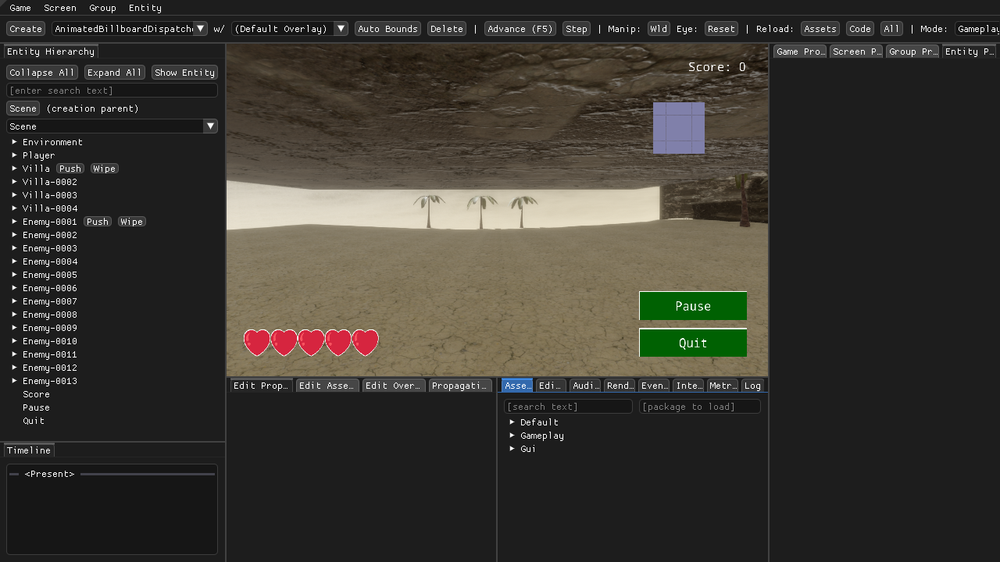

# Gaia's Vulkan renderer on the server's NVIDIA GPU, on a virtual X display (3 November 2026)

**Short answer: it works, with no admin rights and no VirtualGL.**
- Gaia runs its normal Vulkan renderer on the RTX 4090 D while its window lives on our own Xvfb (a virtual X
  display with no monitor). NVIDIA's Vulkan driver can show frames in an Xvfb window.
- **The window is not black.** An X screenshot of the window and Gaia's own frame readback are the same picture,
  pixel for pixel, on both the GPU and the software renderer, in a 2D game and in a 3D game.
- **Speed:** startup takes about 4 s instead of 16 s, and the agent tool checks run in 34 s instead of 118 s.
  The light 2D editor scene runs at 60 frames per second (fps) on both drivers, but the GPU uses half the CPU.
  **For the 3D sample game, the GPU runs at 60 fps; software rendering manages about one frame a minute**, so
  agent tools time out on it.
- All 39 + 11 automatic checks of the agent tools pass on the GPU.

Background: nu-value-research put the older OpenGL version of Nu on this GPU through VirtualGL (a library that
moves OpenGL rendering onto a GPU and copies the frames back to X). There, Nu's window stayed black. Vulkan does not
go through VirtualGL, so we tested whether NVIDIA's Vulkan driver can show frames in an Xvfb window by itself.
It can. An earlier note in `investigation.md` said it could not. That was an assumption that had never been tested,
and it is now corrected.

## Recipe

With this repository's launcher (it starts its own Xvfb with an access cookie, then Gaia, then the agent bridge):

```bash
nvidia-smi                                   # shared GPU: check who else is using it first
GAIA_VULKAN=nvidia GAIA_DISPLAY=:92 docs/agentic-gaia/prototype/run_gaia_headless.sh [PROJECT_DLL]
# optional: GAIA_EDIT_MODE=Gameplay opens a project's editor mode at start (Terra Firma: Splash|Title|Credits|Gameplay)
```

Without the launcher, the only settings that matter are:

```bash
export DISPLAY=:92 XAUTHORITY=/path/to/your/xauth        # your own Xvfb, e.g. Xvfb :92 -screen 0 1920x1080x24 -nolisten tcp -auth ...
export VK_ICD_FILENAMES=/usr/share/vulkan/icd.d/nvidia_icd.json  # Vulkan driver list (older loaders)
export VK_DRIVER_FILES=/usr/share/vulkan/icd.d/nvidia_icd.json   # same, name used by newer loaders
nice -n 5 dotnet Nu.Gaia.dll                                     # no VirtualGL, no Mesa variables
```

**Check every time:**
- Gaia's log must say `Selected Vulkan Device NVIDIA GeForce RTX 4090 D, Driver v1.4.312(0)`. With software
  rendering it says `llvmpipe (LLVM 15.0.7, 256 bits)`.
- `nvidia-smi` must list the `dotnet` process (type `C+G`), using about 1.2 GB (2D) to 1.5 GB (3D) of GPU memory.

The launcher's default is still `lavapipe` (Mesa's software Vulkan). That keeps the recorded study reproducible,
and an agent session does not hold the shared GPU unless asked. Both are Vulkan. Use `nvidia` for anything 3D
and whenever speed matters.

## What was measured

Setup: Gaia from branch `agentic-gaia` (Debug build of 2 Nov), Xvfb 1920x1080, Gaia window 1280x720. NVIDIA
driver 580.178.04; Mesa lavapipe 23.2.1 with the launcher's `LP_NUM_THREADS=4`. One Gaia at a time. The GPU was
otherwise idle. Scripts and raw output are in `gpu-vulkan/` (see "Files" below).

### 1. Device and GPU process

On every NVIDIA launch, Gaia selected the RTX 4090 D, and `nvidia-smi` showed the `dotnet` process. Swapchain
creation (the Vulkan step that connects the renderer to the window) did not fail.

### 2. Is the picture right?

| Scene | X screenshot vs readback, same driver | NVIDIA vs lavapipe readback |
| --- | --- | --- |
| Breakout (2D), editor at start | identical (0 pixels differ), both drivers, 2 runs each | 1.4% of pixels differ, mean difference 0.014 of 255 |
| Terra Firma (3D), Gameplay mode | identical, both drivers | same scene; 23% of pixels differ, mean 0.5 of 255 (max 215) |

Two NVIDIA runs of Breakout gave byte-identical images. The NVIDIA and lavapipe 3D captures were taken at
different editor frames (about 12 on lavapipe, a few hundred on NVIDIA). They also come from different
rasterisers. So small shading differences are expected. We did not try to separate those two causes.



The lavapipe readback of the same scene for comparison: `img/gpu-terra-firma-lavapipe-readback.png`. Breakout on
the GPU: `img/gpu-breakout-nvidia-xvfb.png`.

### 3. Timing

The same short scripted session on each driver (`gpu-vulkan/time_session.py`): render 600 editor frames, advance
the game 600 frames, take 20 frame readbacks and 20 X screenshots, run one F# eval. Breakout, two runs each:

| | NVIDIA | lavapipe |
| --- | --- | --- |
| Launch until the agent bridge answers | 3.6 s, 4.6 s | 15.7 s, 16.2 s |
| 600 editor frames | 9.96 s (60 fps) | 10.7 s, 10.2 s (56, 59 fps) |
| Advance the game 600 frames | 10.2 s | 13.8 s, 12.3 s |
| 20 frame readbacks | 1.7 s, 1.8 s | 2.4 s, 2.3 s |
| Whole session | 25.2 s, 25.6 s | 29.8 s, 28.4 s |
| Gaia's CPU use during the session | 2.0, 1.9 cores | 4.1, 4.1 cores |
| `check_mcp.py` (39 checks, includes one Gaia restart) | 34 s, 39/39 pass | 118 s, 39/39 pass |
| `check_review_fixes.py` (11 checks) | 4.8 s, 11/11 pass | 5.0 s, 11/11 pass |

The 2D editor is capped near 60 fps on both drivers. Nu asks for vsync (`Constants.Render.RenderVsync`, the
`Fifo` present mode), so for a light scene the GPU mostly saves CPU and startup time, not frame time.

Terra Firma (3D, Gameplay mode):

| | NVIDIA | lavapipe |
| --- | --- | --- |
| Launch until the agent bridge answers | 9.1 s, 3.6 s | 17.2 s, 16.2 s |
| Editor frame rate | 60 fps (600 frames in 10.0 s) | 2nd frame after about 10 min, then about 1 frame per 60–75 s (7 frames in 15 min) |
| Advance the game 600 frames | 10.3–10.8 s | not possible in practice (would take about 10 hours) |
| Gaia's CPU use | 3.1–6.3 cores (game logic and physics) | about 2.8 cores |
| GPU use | 1.45 GB, 22–44% busy, about 30 W | none |

On lavapipe, the agent bridge reports the editor as unresponsive between frames (its watchdog fires after 10 s
without a frame), so the normal agent tools fail on this scene. One readback took about 6 minutes to obtain.
NVIDIA is roughly 4,000 times faster here.

### 4. Why the OpenGL route showed a black window and this one does not

We did not look inside either driver, so this is a likely explanation, not a proven one. VirtualGL redirects
OpenGL calls and copies frames back to X itself. Nu draws from two threads, and that probably breaks the copy.
With Vulkan there is no redirection: Gaia talks to NVIDIA's Vulkan driver directly. The driver reports that it can
present to the Xvfb window and puts each frame there. The X screenshot matching the readback shows the frames
really arrive.

## Caveats

- **Shared GPU.** An open Gaia renders every frame. It holds 1.2–1.5 GB and keeps the GPU 11% (2D) to 44% (3D)
  busy even when the agent is idle. Check `nvidia-smi` first, run one Gaia at a time, and stop Gaia when the
  agent is done.
- **Only Gaia with Breakout and Terra Firma were tried**, with one driver version (580.178.04). Other sample
  projects were not run.
- **Results recorded with lavapipe** (the round-3 comparison study) used software rendering. Pictures from the
  two drivers differ slightly (section 2), so don't compare pixels across drivers. The recorded study is not
  affected: it ran entirely on lavapipe. A rerun on the GPU should say which driver it used.
- The timings are from one shared server on one evening, two runs each. They show the size of the difference,
  not precise benchmarks.

## Files

- `gpu-vulkan/compare_drivers.sh`: launches Gaia on each driver in turn, then runs the next two scripts.
  Usage: `[PROJECT=DLL] [GAIA_EDIT_MODE=M] compare_drivers.sh OUT_DIR nvidia lavapipe ...`
- `gpu-vulkan/compare_capture.py`: one frame readback and one X screenshot; writes both PNGs and compares them.
- `gpu-vulkan/time_session.py`: the timed session in section 3.
- `gpu-vulkan/frame_probe.py`, `slow_capture.py`: for the very slow lavapipe 3D run (count frames; get one readback).
- `gpu-vulkan/imgdiff.py`: compares two PNGs.
- `gpu-vulkan/results/`: raw output (`breakout-summary.txt`, `terra-firma-summary.txt`, the lavapipe frame log,
  `nvidia-smi` samples, check results and timings).
- Launcher changes (`prototype/run_gaia_headless.sh`): `GAIA_VULKAN=nvidia` also sets `VK_DRIVER_FILES`; new
  optional `GAIA_EDIT_MODE`. The comment that said NVIDIA cannot present to Xvfb is corrected.
